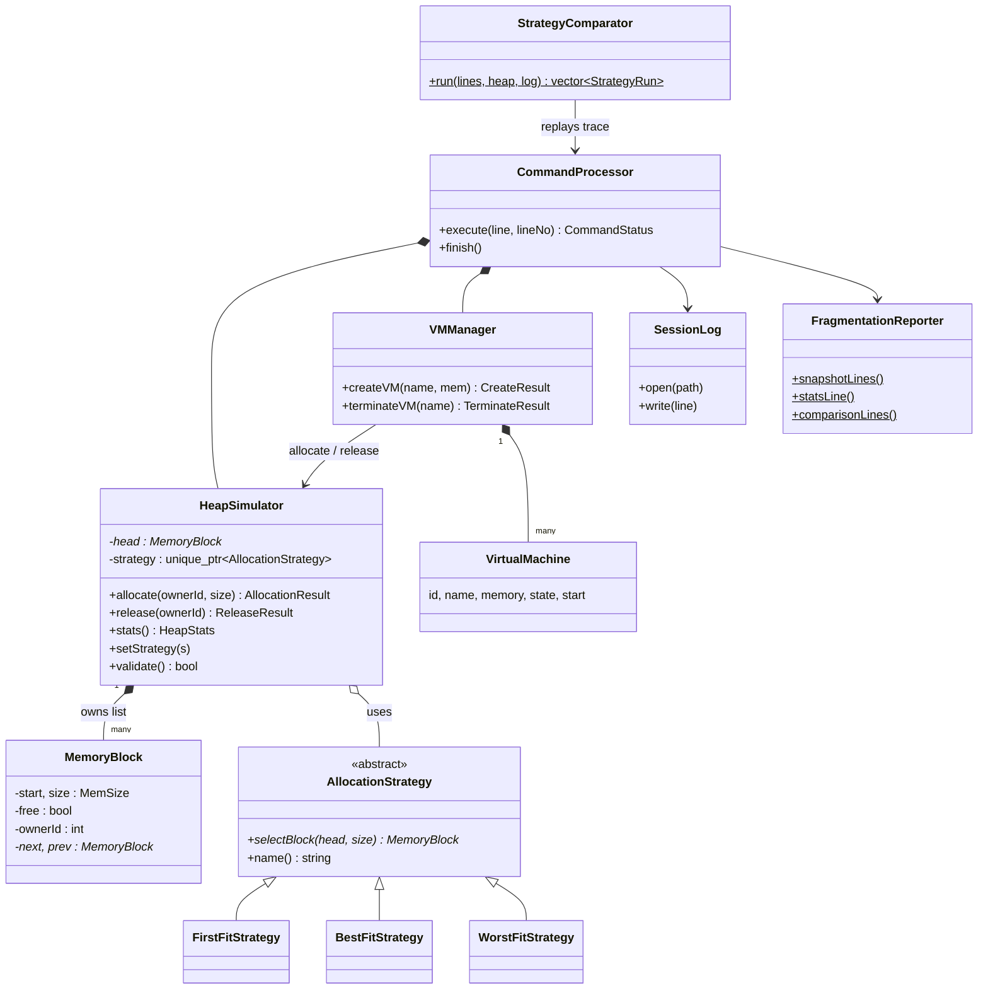

# HeapTrace — design notes

This document maps the Phase-II report/presentation to the code, explains the algorithms and the decisions behind them,
and lists the limitations honestly. Read it before the viva: every team member should be able to explain any part of it.

## 1. The five layers of the report and where they live

| Layer (Phase-II report) | C++ (`cpp/`) | C (`c/`) |
|---|---|---|
| 1. Input: host memory + trace of create/terminate requests | `main.cpp` (reads the trace), `CommandProcessor` (parses lines) | `main.c`, `processor.c` |
| 2. VM Manager | `VirtualMachine.h/.cpp` — `VirtualMachine`, `VMManager` | `vm.c` — `VirtualMachine`, `VMManager` |
| 3. Allocation engine | `HeapSimulator`, `MemoryBlock` — own the linked list; split on allocate, merge on release | `heap.c` — `Heap`, `MemoryBlock` |
| 4. Strategy layer | `AllocationStrategy` (abstract) → `FirstFitStrategy`, `BestFitStrategy`, `WorstFitStrategy` (stretch goal) | `Strategy` struct holding a function pointer; `HT_FIRST_FIT`, `HT_BEST_FIT`, `HT_WORST_FIT` |
| 5. Output: snapshots, statistics, `fstream` log | `FragmentationReporter`, `SessionLog` (`std::ofstream`), `StrategyComparator` | `report.c`, `log_*` in `util.c` (`FILE*`), `compare.c` |

Report requirements and their status in this code:

| Requirement (report / slides) | Where |
|---|---|
| Linked list of `MemoryBlock` nodes, no STL container for the heap | `MemoryBlock`, `HeapSimulator` (hand-written doubly linked list, destructor frees every node) |
| Split on allocation, coalesce on release | `HeapSimulator::allocate` / `release` |
| Pluggable strategy through a base-class pointer, switchable at run time | `HeapSimulator::setStrategy`, command `STRATEGY` |
| Create / terminate VM commands | `VMManager`, commands `CREATE` / `TERMINATE` |
| Refuse and log a VM that does not fit, heap unchanged | `CREATE` → `[REJECTED]`; verified by tests |
| Fragmentation: free blocks, largest free block, total free, external fragmentation = 1 − largest/total free | `HeapSimulator::stats()`, `FragmentationReporter::statsLine` |
| Replay identical traces under each strategy | `StrategyComparator` (`compare` command) |
| `fstream` session log of every operation and snapshots | `SessionLog` |
| Test cases: first-fit, best-fit, split/coalesce, request that does not fit | `cpp/tests`, `c/tests`, `traces/` |
| Worst-fit (stretch goal) | `WorstFitStrategy` |

## 2. Class diagram (C++)

## 3. The heap list and its invariants

The server memory `[0, total)` is one doubly linked list of blocks in address order. `HeapSimulator::validate()` (and
`heap_validate()` in C) checks **all** of these, and the stress tests call it after every single operation:

1. the first block starts at 0, each block starts where the previous one ends, the last ends at `total` (no gap, no overlap);
2. every block has size ≥ 1; `prev`/`next` links agree with each other;
3. a free block has no owner, a used block has an owner id ≥ 0;
4. **no two free blocks are adjacent** (they would have been merged);
5. therefore `used + free == total` at all times.

A doubly linked list is used because coalescing on release needs the *predecessor* of the freed block; with a singly linked
list that costs an extra scan per release.

## 4. Algorithms

**allocate(owner, size)**: `block = strategy.selectBlock(head, size)`. If none → rejected; the reason is *Fragmentation* if
`totalFree ≥ size` (enough memory exists, but not contiguous) and *InsufficientMemory* otherwise. Otherwise, if the block is
larger than `size`, **split** it: the front `size` MB become the VM's block, the tail becomes a new free node linked in
after it. An exact fit just flips the block to used. The heap is not touched when the request is rejected.

**release(owner)**: find the block owned by `owner`, mark it free, then **merge with the next block if free**, then **merge into
the previous block if free** (deleting the absorbed node each time). `merges` (0, 1 or 2) is reported.

| Strategy | Rule | Tie-break | Cost |
|---|---|---|---|
| First-fit | first free block (lowest address) with `size ≥ request` | – | O(n), stops early |
| Best-fit | free block with the smallest `size ≥ request` | lowest address | O(n) always |
| Worst-fit | free block with the largest `size ≥ request` | lowest address | O(n) always |

(n = number of blocks.) Allocation and release are both O(n) in the worst case; `stats()` is O(n).

**Metrics.** `externalFragmentation = 1 − largestFree / totalFree` (0 when nothing is free, so there is never a division by
zero). The comparison table also reports `AvgFrag` and `PeakFrag`: the fragmentation is *sampled after every CREATE and
TERMINATE command that changes or tests the heap* (a rejected CREATE is sampled too; skipped terminations and syntax errors are
not), and the mean and maximum of the samples are shown. `FinalFrag` is the value at the end of the trace.
Note that this metric only looks at the *largest* free block; two heaps with the same value can differ in how many small
holes they have (the `FreeBlks` column shows that).

## 5. Design decisions and trade-offs

* **Deterministic tie-breaking** (lowest address) makes every run reproducible and lets the C and C++ versions be compared
  byte for byte.
* **No minimum remainder.** A split may leave a free block of 1 MB. Real allocators often refuse to split below a threshold
  to avoid slivers; HeapTrace keeps the textbook behaviour so fragmentation effects stay visible.
* **VM identity.** Each CREATE request gets a sequential id (also rejected ones), the heap tracks ownership by id, and VM
  *names* are what traces use. A name can be reused after the VM terminated or was rejected; creating a name that is
  currently running is an error, not a rejection.
* **Rejected VMs are recorded**, and terminating one later is `[SKIPPED]` rather than an error. Without this, the same trace
  would produce different error counts under different strategies (a VM rejected by one strategy may be placed by another).
* **Replay for comparison** runs the trace on a fresh heap per strategy with output silenced; `STRATEGY` and `COMPARE` lines in
  the trace are ignored there so the strategy under test cannot change mid-run.
* **Defensive engine.** `allocate` re-checks that the block chosen by a strategy really is free and large enough, so a faulty
  custom strategy can corrupt nothing; all sizes are capped at 10¹² MB so no sum can overflow `long long`.
* **C version.** C has no classes: `AllocationStrategy` becomes a struct holding a function pointer (the same run-time
  dispatch a C++ vtable performs), destructors become `*_destroy` functions, exceptions become `NULL` returns, `std::string`
  and `std::vector` become `StrList` / `StrBuf`. Behaviour and output are identical by construction and by test.

## 6. Limitations — say these before the evaluator does

* One server and **one resource (memory)**. Real VM placement also considers CPU, storage and network, and chooses among many
  hosts; the mentor deliberately limited the scope. A hypervisor also does not give a VM one contiguous physical block (it uses
  paging), so "VM = contiguous allocation" is an *analogy* that makes fragmentation visible, not a model of a real hypervisor.
* Traces are untimed sequences of events; there is no notion of VM lifetime distributions, arrival rates or migration/compaction.
* Only three classic policies. Next-fit, buddy allocation or compaction would be natural extensions.
* The synthetic workload of `gen` (uniform sizes, 50 % creates) is a convenience, not a validated model of cloud workloads.
* Results on a handful of traces are anecdotes; Phase-III should aggregate many runs and state the assumptions.

## 7. Questions to be able to answer (viva / individual evaluation)

*Engine.* Why must a freed block be merged with *both* neighbours, and in which order does the code do it? Which invariant
would break if the merge with the previous block were skipped (hint: invariant 4, and what the next `CREATE` could then miss)?
What is the complexity of `allocate` for each strategy? Why is `externalFragmentation` 0 when nothing is free?

*OOP.* Where exactly does run-time polymorphism happen, and what would you have to change to add next-fit? Why is the
destructor of `AllocationStrategy` virtual? Why does `HeapSimulator` own the strategy through `unique_ptr`?

*Evidence.* In the worked example, why does first-fit reject F = 290 MB although 570 MB are free? Which of the three
strategies would you pick for a real server and what evidence from your *own* runs supports that? What would change your mind?

*Process.* What alternatives to a linked list did you consider (e.g. a balanced tree keyed by size for best-fit)? Who is the
user of this tool and how would you measure that it taught them something?
